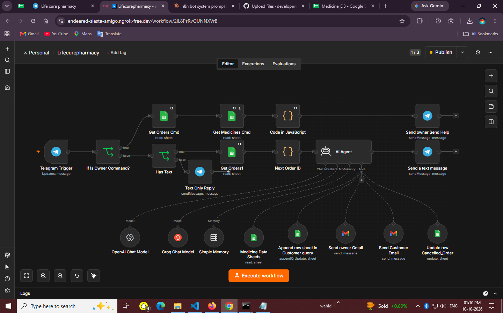
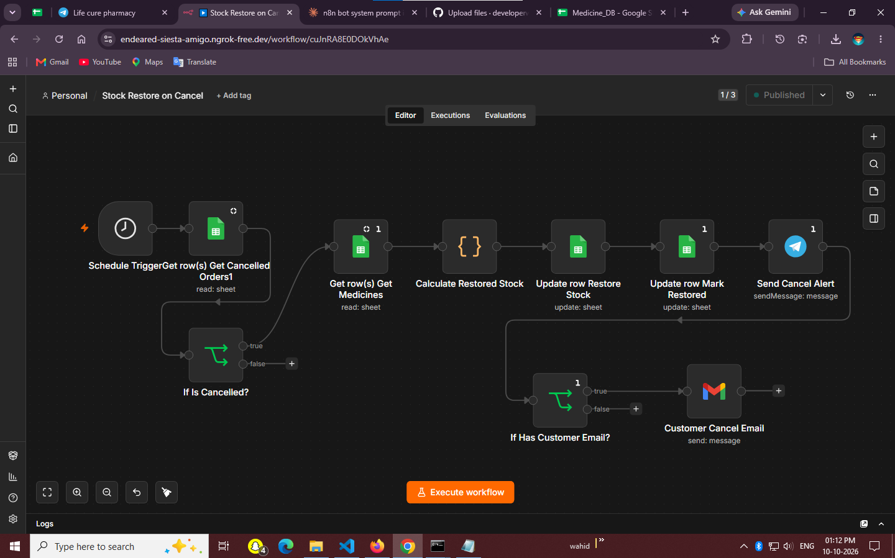
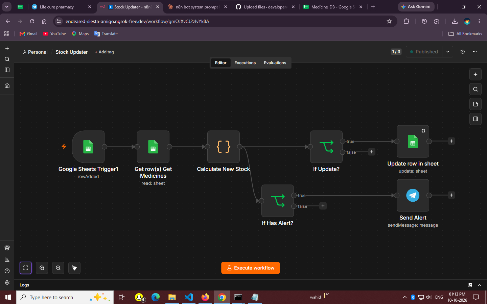
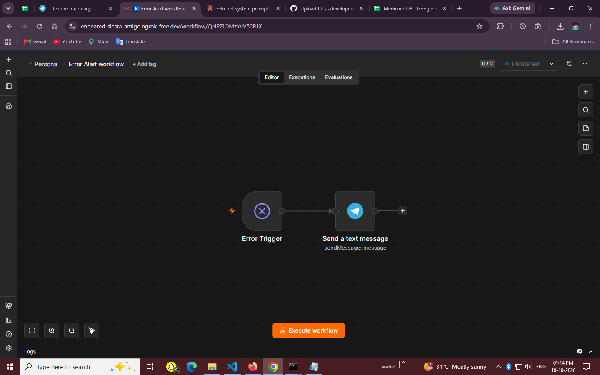
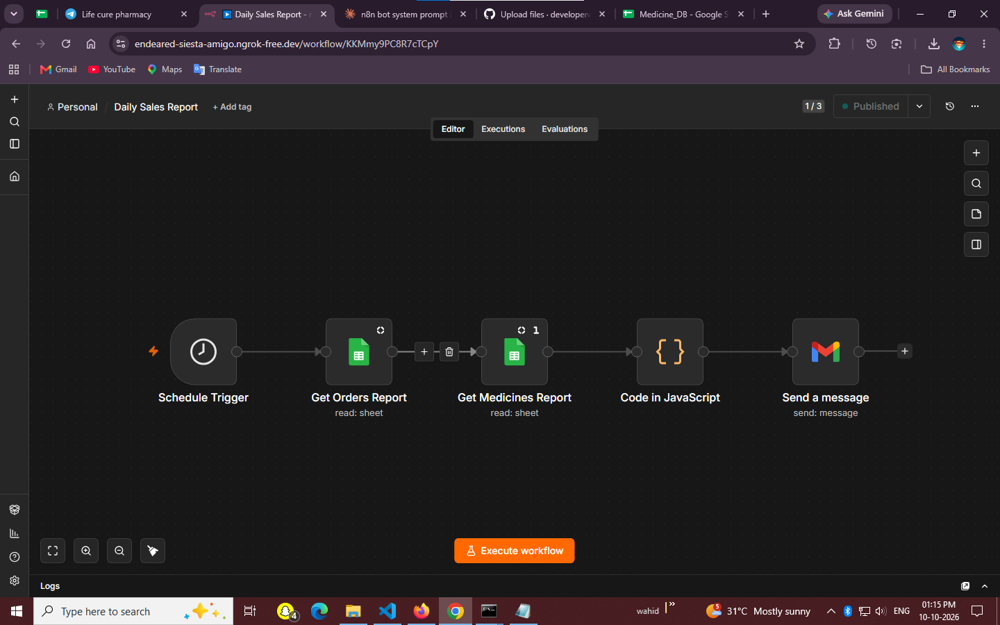
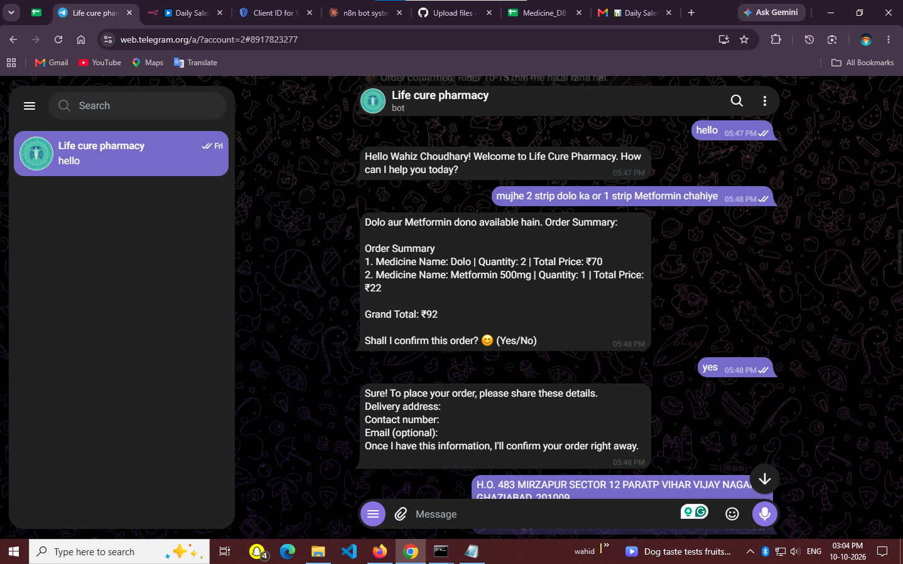
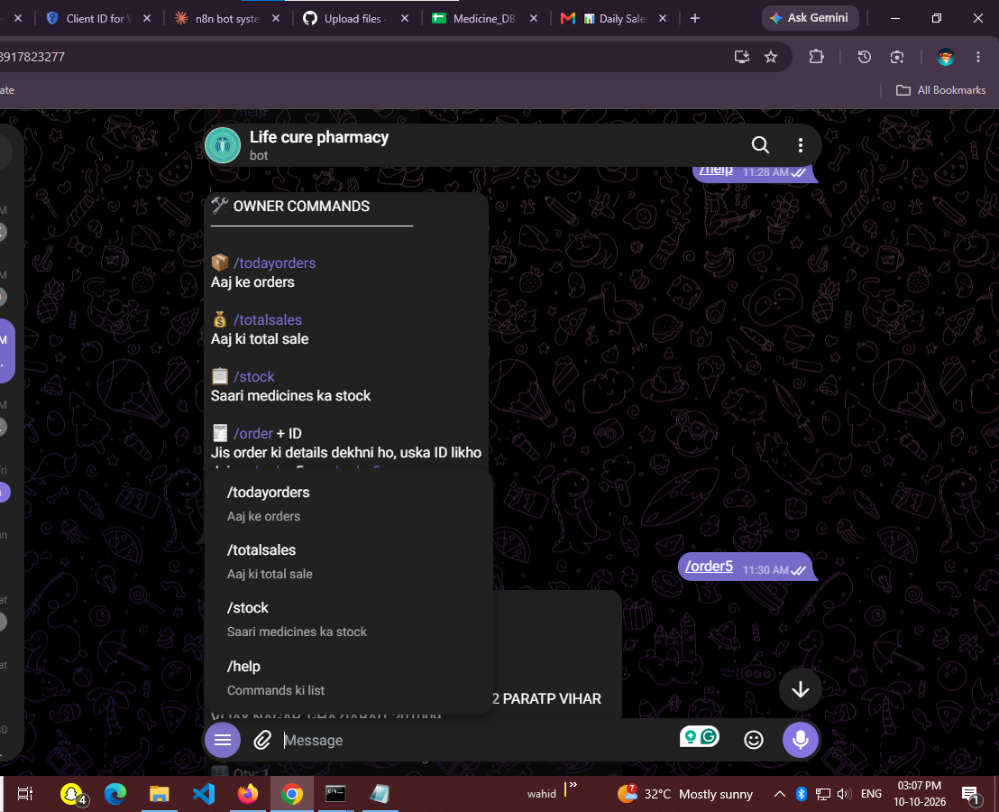
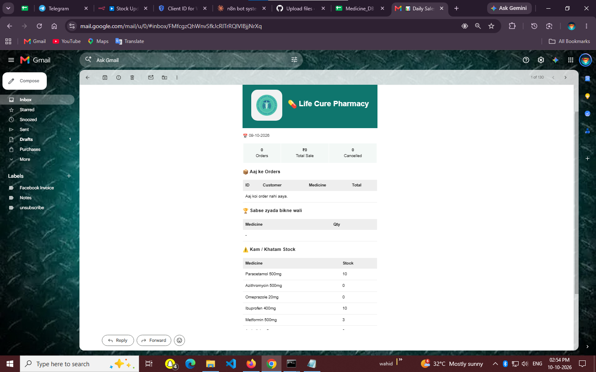

# 💊 Life Cure Pharmacy — AI Telegram Bot (n8n)

An AI-powered Telegram bot for a pharmacy. Customers search medicines, check availability and place or cancel orders in Hindi, Hinglish or English. The owner gets instant alerts, Telegram commands and a daily sales report.

Built with **n8n**, **OpenAI** (Groq as fallback), **Google Sheets** and **Gmail**.

---

## ✨ Features

**Customer side**
- Chat in Hindi / Hinglish / English
- Medicine search with price and live stock
- Quantity check before ordering (no over-ordering)
- Multi-medicine orders in one go
- Order saved to Google Sheets with sequential Order ID
- Cancel order by chat (stock is restored automatically)
- Optional confirmation and cancellation emails to the customer

**Owner side**
- Telegram alert for every new order, cancellation, low stock and out of stock
- Owner commands in Telegram (see below)
- Daily sales report on Gmail at 8 PM
- Error alert on Telegram when any workflow fails

---
## 📸 Screenshots

### Main bot workflow


### Stock Restore on Cancel


### Stock Updater


### Error Alert


### Daily Sales Report


### Telegram order flow


### Owner commands


### Daily sale report Gamil


## 🤖 Owner Commands

| Command | What it does |
|---|---|
| `/todayorders` | Today's orders (cancelled ones excluded) |
| `/totalsales` | Today's total sale and order count |
| `/stock` | Full stock list (✅ ok, ⚠️ low, ❌ out) |
| `/order <ID>` | Details of one order, e.g. `/order 5` |
| `/help` | Command list |

Commands work only for the owner's Telegram chat ID.

---

## 🧱 Workflows

| Workflow | Trigger | Purpose |
|---|---|---|
| **Life Cure Pharmacy (main bot)** | Telegram Trigger | AI Agent for customers + owner commands |
| **Stock Updater** | Google Sheets: new row in Customer_Orders | Reduces stock, sends low/out-of-stock alerts |
| **Stock Restore on Cancel** | Schedule (every 1 minute) | Restores stock for cancelled orders, alerts owner, emails customer |
| **Daily Sales Report** | Schedule (8 PM IST) | Emails the day's report to the owner |
| **Error Alert** | Error Trigger | Telegram message when any workflow fails |

### Main bot flow
```
Telegram Trigger
  └─ Is Owner Command?
       ├─ true  → Get Orders → Get Medicines → Code (builds reply) → Telegram
       └─ false → Has Text? → Get Orders → Next Order ID → AI Agent → Telegram
```

AI Agent tools: Medicine Data Sheets, Append row (orders), Update row (cancel), Send owner Gmail, Send Customer Email. Memory: Simple Memory (window 5).

---

## 🗂 Google Sheet: `Medicine_DB`

**Medicine_data**: Medicine Name, Generic Name, Price, Stock (formula), Quantity, Category

**Customer_Orders**: Order ID, Customer Name, Contact Number, Customer Email, Customer Address, Medicine Name, Quantity, Price Per Unit, Total Price, Order Status, Order Date (`dd-MM-yyyy HH:mm`), Telegram Chat ID, Stock Restored

Multi-medicine orders are stored comma-separated (e.g. `Dolo, Paracetamol 500mg` / `2, 2` / `35, 25`).

---

## ⚙️ Setup

1. Create a Telegram bot with **@BotFather** and add the token as a Telegram credential in n8n.
2. Create the Google Sheet `Medicine_DB` with the two tabs above and connect Google Sheets and Gmail credentials.
3. Add OpenAI (and optionally Groq) credentials.
4. Import or build the five workflows, set the system prompt on the AI Agent, and replace the owner chat ID with your own.
5. In every workflow open **Settings → Error Workflow** and choose `Error Alert`; set timezone to `Asia/Kolkata`.
6. **Save and Publish** each workflow.
7. In BotFather run `/setcommands` to add the owner command menu.

---

## ⚠️ Notes and Lessons

- Never run stock workflows manually with **Execute workflow**: it acts on real sheet rows and changes stock.
- `$fromAI()` works only inside AI Agent tool nodes, not in normal Gmail or Telegram nodes.
- Keep the Stock column as a formula and never overwrite it; the workflows write to Quantity.
- Only one Telegram Trigger is allowed per bot.
- Scheduled workflows run only while n8n is running. Move n8n to a VPS with a domain for 24/7 operation.
- To save tokens: short prompt, small memory window, a small model such as `gpt-4o-mini`.

---

## 🚀 Ideas for Later

Order tracking and previous orders, PDF invoice, estimated delivery time, edit order, find orders by phone number, WhatsApp version.
